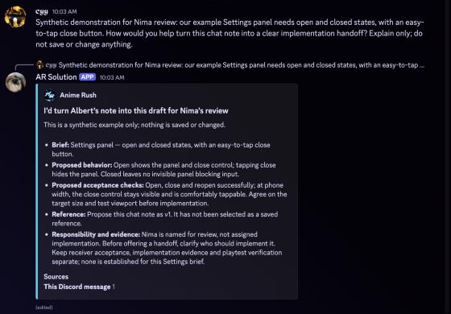

# Nima — feature demonstration

Nima's Discord work interface uses the server nickname **AR Solution**. The underlying application is Nima (`1547312805215211682`).

This page demonstrates an ordinary, unmentioned message being handled by the bot in its private test channel. The example is synthetic: a Settings panel with open and closed states and an accessible close target. It contains no real team discussion, personal data, or game values. No work record is created by this demonstration.

The companion catch-up function reads operator-selected server conversations and returns summaries with links to their original messages. Message Content is necessary because the source discussion ordinarily consists of messages that neither mention the bot nor invoke an application command.

## Screenshot

An ordinary message in the bot's private test channel (no mention, no slash command) and Nima's reply, captured October 29, 2026:

